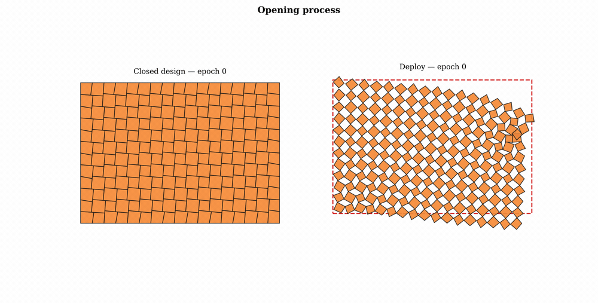

# Neural Form-Finding

Differentiable inverse design of kirigami. A **flat, closed sheet** is cut along a pattern of
slits, pulled or twisted at its boundary, and deploys into a target shape. The pipeline finds the
cut pattern by gradient descent *through* the physics of that deployment: the design parameters
build the flat sheet, a static equilibrium solve deploys it, and the shape error is
back-propagated through the equilibrium (implicit differentiation) to the cuts.

Developed at the **Princeton Form Finding Lab**.

<p align="center">
  
</p>
<p align="center"><em>The flat closed design (left) reorganises during training so that the physics-deployed sheet (right) fills its target.</em></p>

---

## How it works

```
design parameters  {z: per-cut aspect ratios r = sigmoid(z),  boundary sliders}
        │
        ▼  Stage 0 — closed chart  (nff/stages/mapping.py :: apply_closed_les_mapping)
        │   Collinearity linear system -> flat RDPQK sheet (Dang et al. 2021).
        │   Valid by construction (Tutte embedding): no self-intersection, no repair step.
        │
        ▼  Stage 2 — deployment by physics  (nff/stages/physics/)
        │   Minimise the total potential energy of panels + hinges under the applied loads
        │   (forces, moments, or prescribed displacements), incremental load stepping in
        │   jax.lax.scan, L-BFGS with an implicit-function-theorem adjoint (jaxopt).
        │
        ▼  Loss  (nff/training/loss.py)
            symmetric boundary-to-target shape error
          + optional hinge terms: compression, damage, path maximum, regularisation
```

The hinge energy is a config switch (`hinge_model.type`):

| `rom` | the classical linear-spring hinge (`k_stretch`, `k_shear`, `k_rot`), constants condensed from FEA (`nff/stages/physics/energy.py`) |
|---|---|
| `surrogate` | a learned condensed hinge energy `W(a, s, θ; w_lig, α)` trained on CalculiX simulations of a single cut hinge, with damage and an out-of-domain barrier (`nff/models/hinge_surrogate.py`) |

The surrogate is built by a separate data loop:

```
nff/rve/ (CalculiX RVE oracle)  ->  generate_hinge_dataset.py  ->  data/fea/<dataset>.npz
                                ->  train_hinge_surrogate.py   ->  data/surrogates/<name>.pkl
                                ->  hinge_model.checkpoint in a closed config
```

---

## Quick start

```bash
conda env create -f environment.yml && conda activate kgnn_mac
pip install -e .

# Inverse design (forces float64 and CPU; writes everything into one run folder)
JAX_PLATFORMS=cpu python nff/scripts/run_closed.py --config-name circle_4x4_surrogate --every 5
#   -> data/outputs/runs/run_<timestamp>_<config>/  (loss history, design trajectory,
#      deployed sheet, cut pattern PNG/DXF/A4 PDF)

# Tests (the suite pins the CPU backend itself)
pytest -q
```

Configs live in `data/configs/closed/`. Flip `hinge_model.type` between `rom` and `surrogate`
to change the hinge physics; the target must be fixed in the config, never adaptive.

### Building a hinge surrogate

```bash
# CalculiX campaign (needs the `ccx` conda env); resumable, checkpoints every batch
bash nff/scripts/surrogate/run_pet_campaign.sh start          # | resume | stop | status

# Fit the surrogate on the resulting dataset (split by job, Sobolev loss, best-on-val)
JAX_PLATFORMS=cpu python nff/scripts/train_hinge_surrogate.py \
    --data data/fea/<dataset> --epochs 300 --lam 0.7 --out data/surrogates/<name>
```

### Putting a design on a real sheet

```bash
python nff/scripts/design/calibrate_target.py ...   # size the target from the deployment angle
python nff/scripts/design/export_cut_layout.py ...  # datum, coordinate tables, A3 cutting sheets
python nff/scripts/design/export_cut_dxf.py ...     # laser-cut DXF
```

---

## Repository layout

```
nff/                      the research pipeline
├── topology/             closed RDPQK builder (numpy + differentiable JAX), cut pattern, hinge descriptor
├── config/               ExperimentConfig, targets, conditions
├── stages/               pipeline, mapping (Stage 0), physics/ (Stage 2), state; validity/projection (Stage 1, ablations only)
├── models/               hinge_surrogate.py
├── training/             loss registry, trainer
├── closed/               closed-pipeline glue: setup, deploy, cut export/layout, hinge paths, load paths, force stats
├── rve/                  CalculiX hinge oracle: geometry, solver, damage, materials (steel, PET, paper), dataset, path prior
├── calibration/          tensile-coupon analysis (Bluehill, compliance, video extensometer) behind the PET material law
├── utils/                linalg, figure style, run visualisation, splits, routes
└── scripts/
    ├── run_closed.py  train_hinge_surrogate.py  generate_hinge_dataset.py     entry points
    ├── surrogate/        oracle validation, path harvesting, dataset audits, path dependence, campaign control
    ├── calibration/      PET coupon and campaign-preparation tools
    ├── design/           target calibration, cut-layout and DXF export
    └── diagnostics/      gradient parity, Taylor test, design-loss landscape, load paths

nff_paper/                the PFE article and the defense deck (imports nff, never the reverse) — see nff_paper/README.md
legacy/                   archived approaches: GNN/MPNN/EGNN, SOFA/Tesseract, open-pattern maps, one-off probes — see legacy/README.md
data/                     configs/closed (tracked), outputs, fea datasets, surrogates, lab experiments (gitignored)
docs/                     research notes: surrogate plans and audits, dataset runbook, calibration protocols, cleanup log
tests/                    core tests; tests/paper/ for the article modules; test_layering.py enforces the package boundaries
```

The manuscript itself lives in `paper/` (Overleaf-synced, not versioned here).

---

## Central data structure: `CentroidalState`

An immutable `NamedTuple` (`nff/stages/state.py`) that flows through every stage:

| Group | Storage | Fields |
|---|---|---|
| **Optimisable** | `jnp.array` float64 | `face_centroids (n,2)`, `centroid_node_vectors (n, max_nodes, 2)`, mechanical properties |
| **Fixed topology** | `np.array` int32 | `hinge_face_pairs`, `hinge_node_pairs`, `bond_connectivity`, `constrained_face_DOF_pairs`, … |

Topology arrays are **never** JAX tracers: they are static scatter indices inside JIT-compiled
code. Built by `CentroidalState.from_tessellation(tessellation)`.

## Config YAML (closed pipeline)

```yaml
tessellation:          # tessellation_type: closed_rdpqk, M, N, r_init, spacing (or physical sheet size)
mapping:               # map_type: closed_les
optimization_weights:  # validity_method: none   (Stage 1 is bypassed; the chart is valid by construction)
hinge_model:           # type: rom | surrogate, checkpoint, material, thickness_mm, w_lig_mm, barrier
physics:               # incremental, num_load_steps, solver_maxiter, solver_tol, contact
material:              # k_stretch, k_shear, k_rot, density   (the ROM springs)
boundary_conditions:   # clamped_faces
loads:                 # [{face, dof: 0=x | 1=y | 2=theta, value}] or displacement control
target:                # type (circle, rectangle with orientation, ume, ...), center, size
loss_weights:          # chamfer, coverage, hinge terms, regularization
training:              # num_epochs, learning_rate, optimizer, lr_schedule, grad_clip
```

## Conventions

- `_fn` suffix on every factory-produced or callback callable; `build_*` prefix on factories.
- Descriptive array names: `initial_displacements`, not `u0`; `face_centroids`, not `x`.
- Every function touching JAX arrays is pure; PRNG keys are split, never reused.
- Packages import strictly downward (`tests/test_layering.py`).
